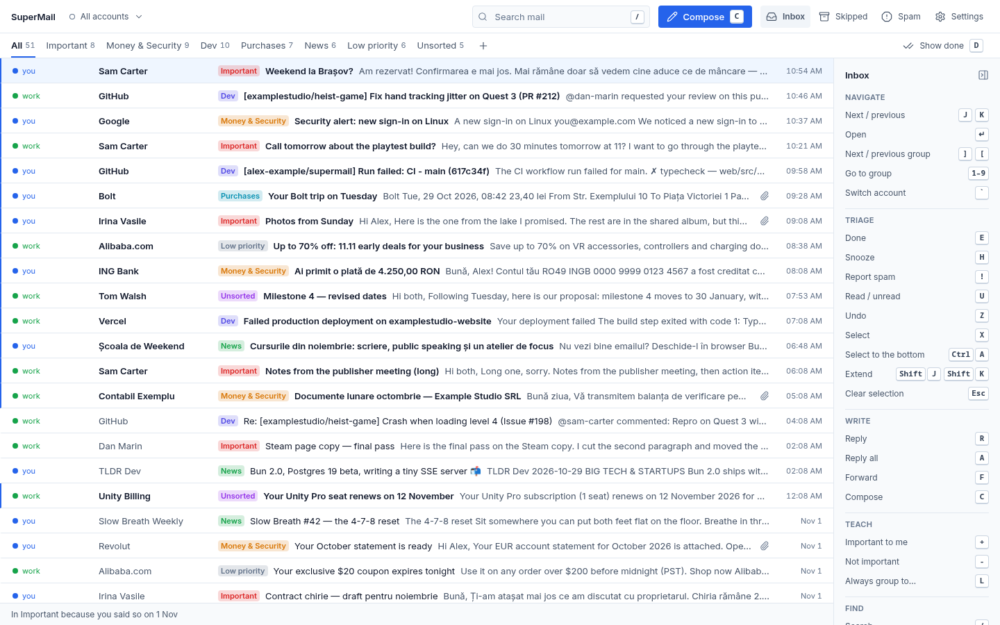
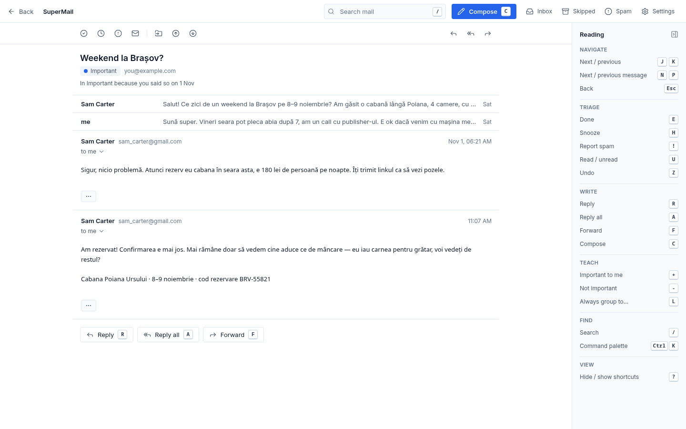
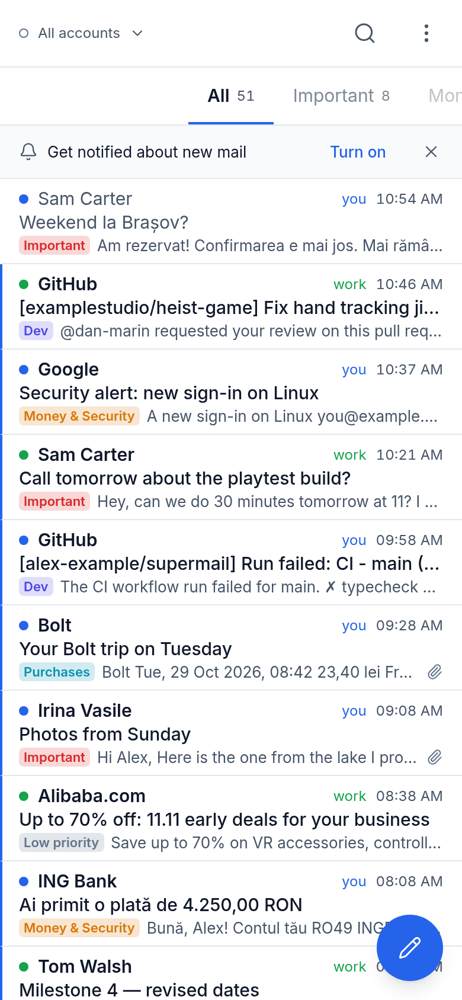
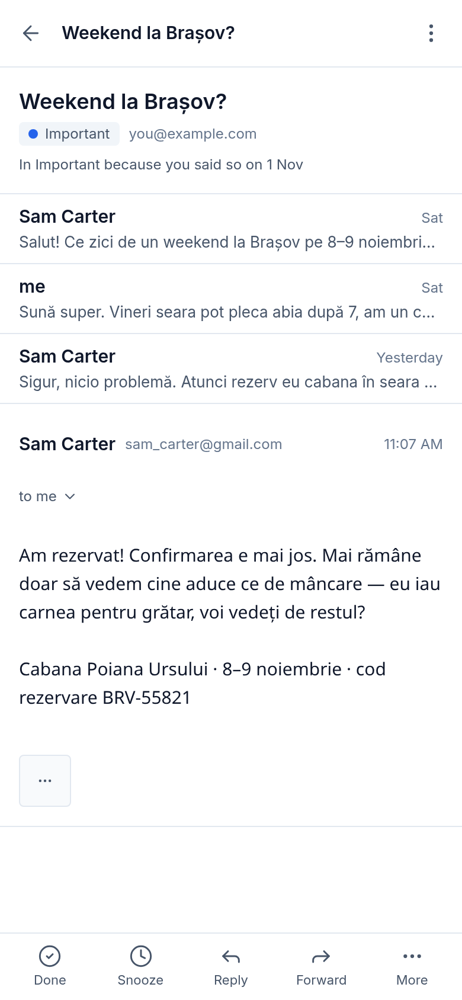

# SuperMail

A self-hosted, keyboard-first Gmail client for one person with several Gmail accounts.

SuperMail runs on your own server, such as a home server or a small VPS, and talks to Gmail through
the Gmail API. Your mail stays in Gmail. SuperMail keeps an index and a limited body cache, and every
action it takes is a normal Gmail label change, so the Gmail app on your phone always agrees with it.



## What it does

- **One merged inbox** for all your Gmail accounts, each with its own color and label, or one account at a time.
- **Groups that learn.** Mail is sorted into groups (Important, Money & Security, Dev, Purchases, News,
  Low priority, Unsorted, plus your own). Every guess says why it was made. When you move a thread or press
  `+` / `-`, SuperMail asks whether you mean this sender, this domain or this mailing list, and remembers.
  Groups are real Gmail labels (`SuperMail/Important`…), so the sorting also shows up in Gmail.
- **Done, snooze and undo.** `E` marks a thread Done (archives it), `H` snoozes it to a time you type
  ("fri 9am"), `Z` undoes the last action, including a bulk one.
- **Bulk actions:** select with `X`, extend with `Shift+J` / `Shift+K`, select to the bottom with `Ctrl+A`,
  then act on hundreds of threads with a single undo.
- **Keyboard first**, with an always-visible shortcut panel and a command palette (`Ctrl+K`).
- **A phone app (PWA):** install it from the browser. Swipe a row to Done or snooze, pull to refresh, and
  get push notifications with Done and Snooze buttons. You can mute notifications for each group, and
  they clear themselves when you handle the mail anywhere.
- **Spam screen:** read spam in a safe reader (no remote images, no tracking pixels), and mark Not spam.
- **"Skipped your inbox":** recent mail that a Gmail filter or another client archived without you seeing
  it, plus a list of the Gmail filters that hide mail.
- **No AI.** Nothing about your mail goes to an AI or analytics service. The sorting is plain rules and
  heuristics that you can read in `server/src/classify/`.

| Thread | Phone inbox | Phone thread |
|---|---|---|
|  |  |  |

All screenshots come from the built-in mock mailbox. Every person, company and address in it is fictional.

## Quick start: try it with no Google account

The mock mode runs the whole web app against an in-memory mailbox of about 60 threads. You need
Node.js 22.12 or later.

```sh
git clone https://github.com/BogdanCodreanu/supermail.git
cd supermail
npm ci
npm run dev:mock
```

Open <http://localhost:5199>. Try `J` / `K` to move, `Enter` to open, `E` for Done, `H` to snooze,
`Z` to undo and `?` to hide the shortcut panel. A new email arrives every 45 seconds. Narrow the window
below 768 px, or use your browser's device toolbar, to see the phone layout. Restarting resets the mailbox.
[`web/mock/README.md`](web/mock/README.md) describes what is in it.

## Real setup

You need three things: a Google OAuth client, a place to run SuperMail, and an HTTPS address for it.

### 1. Create a Google OAuth client

The short version is below. [docs/google-cloud-setup.md](docs/google-cloud-setup.md) has every step.

1. In the [Google Cloud console](https://console.cloud.google.com/), create a project and enable the
   **Gmail API**.
2. In **Google Auth Platform**, set up the consent screen: audience **External**, your own address as
   the support and developer contact, and your SuperMail address as the home page, with
   `https://<your SuperMail address>/privacy` as the privacy policy. SuperMail serves that page itself.
3. Add the scopes `openid`, `.../auth/userinfo.email` and `.../auth/gmail.modify`.
4. Create an OAuth client of type **Web application**, with the authorized redirect URI
   `https://<your SuperMail address>/auth/google/callback`. Add `http://localhost:8787/auth/google/callback`
   too if you will run it locally. Download the JSON; this is your `client_secret.json`.
5. **Publish the app** (Audience → *Publish app*, so its status is **In production**). Do not submit
   it for verification.

**Why production mode matters:** while an app's status is *Testing*, Google expires its refresh tokens after
7 days, so every account would need to reconnect each week. In production, the tokens last until you revoke them.

**The unverified-app warning:** `gmail.modify` is a restricted scope, and your app is not verified by
Google. Each time you connect an account, Google shows **"Google hasn't verified this app"**. Click
**Advanced**, then **Go to … (unsafe)**. This is expected for a personal app: the "developer" Google warns
you about is you. An unverified app can be used by up to 100 Google accounts, which is plenty for one person.

Keep `client_secret.json` out of git: `.gitignore` already ignores `client_secret*.json`.

### 2. Run it

Pick one of the three ways below. SuperMail always needs:

| Setting | Meaning |
|---|---|
| Owner email | The Google address allowed to sign in. Once it has connected accounts, those can sign in too |
| Public URL | The address SuperMail is served at, such as `https://mail.example.com`. The OAuth redirect is built from it, so it must match the redirect URI in the OAuth client |
| Client JSON | The `client_secret.json` from step 1 |

If something is missing, SuperMail stops at startup and says which setting it is.

#### Docker Compose

```sh
cp ~/Downloads/client_secret_*.json ./client_secret.json   # the file from step 1
cat > .env <<'EOF'
SUPERMAIL_OWNER_EMAIL=you@gmail.com
SUPERMAIL_PUBLIC_URL=https://mail.example.com
EOF
docker compose up -d --build
docker compose logs -f        # "listening on 0.0.0.0:8787"
```

[`docker-compose.yml`](docker-compose.yml) builds the image, keeps `/data` in a named volume, mounts the client
JSON read-only, publishes port 8787 on `127.0.0.1` only, and has a healthcheck. Put an HTTPS reverse proxy in
front of it (see [HTTPS](#https-with-a-reverse-proxy)). Make sure `./client_secret.json` exists before
the first start, or Docker creates an empty directory in its place.

For a quick local try with a real account, leave `SUPERMAIL_PUBLIC_URL` unset: it defaults to
`http://localhost:8787`, and secure cookies are off for plain `http://`. Add that address as a redirect URI
in the OAuth client.

The environment variables, for Docker or plain Node:

| Variable | Default | Meaning |
|---|---|---|
| `SUPERMAIL_OWNER_EMAIL` | *(required)* | The Google address allowed to sign in |
| `SUPERMAIL_PUBLIC_URL` | `http://localhost:<port>` | The address SuperMail is served at |
| `SUPERMAIL_HOST` | `127.0.0.1` (`0.0.0.0` in Compose) | The address to listen on |
| `SUPERMAIL_PORT` | `8787` | The port to listen on |
| `SUPERMAIL_SECURE_COOKIES` | on for an `https://` public URL | Send cookies only over HTTPS. Keep it on behind HTTPS |
| `SUPERMAIL_DATA_DIR` | `./.data` (`/data` in Compose) | The index, body cache, logs and `secret.key` |
| `SUPERMAIL_CLIENT_FILE` | `~/.config/supermail/client_secret.json` (`/config/client_secret.json` in Compose) | The Google OAuth client JSON |

#### Home Assistant add-on

SuperMail can run as a local add-on on a Home Assistant OS host (aarch64 or amd64), next to a reverse
proxy add-on on the same host.

1. Copy `deploy/deploy.env.example` to `deploy/deploy.env` and fill it in: `DEPLOY_HOST` is an ssh
   destination for the host, with the `ha` CLI (the *Advanced SSH & Web Terminal* add-on gives you one),
   and `SUPERMAIL_CLIENT_FILE` is the client JSON on your computer. `deploy/deploy.env` is gitignored.
2. Run `deploy/deploy.sh`. It syncs the repo into `/local_apps/super_mail/`, copies the client JSON into
   the add-on's config folder (mode 600, never printed), then installs or rebuilds the add-on and starts it.
3. In Home Assistant, open **Settings → Add-ons → SuperMail → Configuration**, set `owner_email` and
   `public_url`, and restart the add-on.
4. Run `deploy/render.sh` to get a DNS record and a Caddy site block filled from `deploy.env`, then
   `deploy/verify.sh` to check that everything is live.

[`addon/super_mail/README.md`](addon/super_mail/README.md) lists every option and what backups do.

#### Plain Node

```sh
npm ci && npm run build
SUPERMAIL_OWNER_EMAIL=you@gmail.com SUPERMAIL_CLIENT_FILE=./client_secret.json node server/dist/main.js
```

### 3. Sign in

Open your SuperMail address and sign in with the owner email. Then use **Settings → Accounts → Connect
Gmail** for each account. Each one first indexes the inbox and the last 90 days, then older mail in
the background, within the storage limits.

## HTTPS with a reverse proxy

SuperMail listens on `127.0.0.1:8787` and expects a reverse proxy to handle TLS. With
[Caddy](https://caddyserver.com/), which gets and renews the certificate itself:

```caddyfile
mail.example.com {
	reverse_proxy 127.0.0.1:8787
}
```

Point a DNS record for `mail.example.com` at your server, open ports 80 and 443, and reload Caddy.
SuperMail streams live updates over Server-Sent Events (`/api/events`); Caddy passes them through as is.
With another proxy, turn off response buffering for that path.
`deploy/caddy-site.caddy.tmpl` also covers a proxy that only port 443 reaches (TLS-ALPN on another port).

HTTPS is required for real use. Google allows `http://` redirect URIs only for `localhost`, and phones
install the PWA and allow push notifications only over HTTPS.

## Security model

- **One owner.** Only the owner email, and accounts that owner has connected, can sign in. Everyone else
  gets a 403 after Google sign-in. Sessions are httpOnly, SameSite=Lax cookies that last 90 days.
- **Every API write needs an `x-supermail: 1` header**, which a cross-site form cannot send.
- **Access to Gmail** uses the `gmail.modify` scope: read, label, archive and send. It cannot delete mail
  permanently. Refresh tokens are encrypted with AES-256-GCM using `secret.key` in the data directory.
- **Email is rendered in a sandboxed frame** with scripts and forms stripped. Spam is shown with no
  remote content at all.
- **Nothing leaves your server** except calls to Google's APIs and the encrypted push notifications you
  turn on.

[SECURITY.md](SECURITY.md) has the details and how to report a vulnerability.

## Data and storage limits

Gmail stays the source of truth: if SuperMail is down or its data is lost, you lose no mail and no labels.
Teaching rules and groups live in SuperMail's database, and the Gmail labels carry the result.

| Limit | Default | When it is reached |
|---|---|---|
| Body cache | 1024 MB | The bodies read least recently are evicted, then fetched again from Gmail when needed |
| Index | 1024 MB | The oldest archived threads are pruned from the index |
| Logs | 50 MB | Logs rotate |
| Total | 3072 MB | Caching and history indexing stop until there is room |
| Free disk | 20 GB | The same as the total limit, so SuperMail never fills the disk |

The add-on options set these; outside the add-on, the defaults apply. Spam is never stored.
**Settings → Storage** shows the current use.

Back up the data directory if you want to keep your teaching, but leave `secret.key` out (the add-on does
this). After a restore without the key, each account shows **Reconnect**, which takes one click.

## Development

```sh
npm ci
npm run dev:mock               # the web app against the mock mailbox, http://localhost:5199
npm run dev -w server          # the real server on :8787 (needs SUPERMAIL_OWNER_EMAIL and a client JSON)
npm run dev -w web             # the web app on :5173, proxying /api and /auth to :8787
npm test                       # server and web tests (Vitest)
npm run typecheck              # tsc -b over every workspace
npm run build                  # web/dist and server/dist
```

The repo has three workspaces: `shared/` (the API types), `server/` (Fastify, SQLite and the Gmail API)
and `web/` (React, Vite and Tailwind). The server tests use a fake Gmail (`server/test/fakes/fakeGmail.ts`),
so they never touch the network. [docs/design/](docs/design/) holds the design spec, the first
implementation plan and a UX audit.

CI runs typecheck, tests and the build on every push and pull request, plus a gitleaks secret scan.

## License

[MIT](LICENSE)
